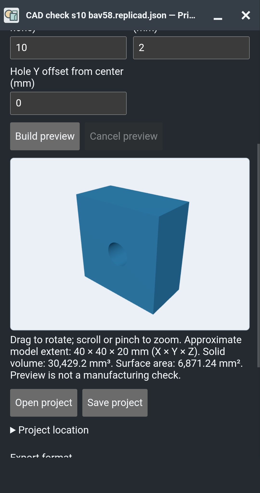
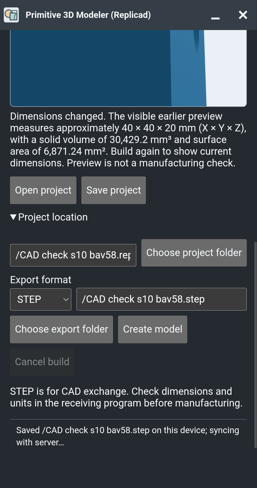

# Replicad on WebOS

Open **3D Printing → Primitive 3D Modeler (Replicad)**. The phone workflow
uses a Galaxy S10+ in portrait at 411 CSS pixels with Chrome
158.0.8127.92. The test installation uses disposable accounts and Files.

1. Build a 40 × 40 × 20 mm box with a 10 mm hole diameter and both offsets
   at 0. Build preview reports about 30,429.2 mm³ and 6,871.24 mm².
2. Drag the preview to rotate it and pinch to zoom. Try an X offset of
   19 mm. The app rejects it and labels the last good preview. Reset to 0.
3. Under **Project location**, enter a plain name such as `CAD check` and
   tap **Save project**. My files gets `CAD check.replicad.json`. Change the
   X offset to 2 mm and save the same project again.
4. Choose **STL**, enter a plain model name and tap **Create model**.
   Repeat with **STEP**. The binary STL has 908 triangles and measures
   40 × 40 × 20 mm. The STEP includes the exchange envelope and advanced
   faces.
5. Close Replicad, open the editable project from **My files** and rebuild
   the preview. The X offset is 2 mm. In the isolated account check,
   signing in from a clean browser session recovered the same file bytes.

## Workflows exercised

| Workflow | S10+ portrait | Desktop Chromium |
|---|---|---|
| Build a box with a through-hole | Passed | Passed |
| Build plain and holed cylinders | | Passed |
| Rotate and zoom the model | Passed | Passed |
| Recover from an invalid hole offset | Passed | Passed |
| Save a project with automatic extension and reject a mismatched extension | Passed | Passed |
| Save a second edit in place | Passed | Passed |
| Reopen an editable project from My files in a fresh signed-in browser | Passed | Passed |
| Reopen through the app's project picker | | Passed |
| Export a binary STL and check its bounds | Passed | Passed |
| Export STEP and check its exchange structure | Passed | Passed |
| Choose an export folder and save inside it | | Passed |
| Cancel and retry replacement of an existing export | | Passed |
| Cancel an active preview worker | | Queued |
| Cancel an active export worker | | Queued |
| Recover a project after a concurrent Files edit | | Queued |

Portrait covered 8 of 15 documented workflows. Desktop covered 12 of 15.
The 820 × 1050 Chromium touch-tablet layout passed the core file cycle and
kept the app bar available. The dark status text measured 13.32:1 on all
three layouts. Physical landscape is queued for the separate orientation pass.

The reference checks run with `npm ci` and `npm run test:reference`.
WebOS builds this repository with its public app builder, using `app.json`
to bundle the independent geometry worker and OpenCascade WASM.
